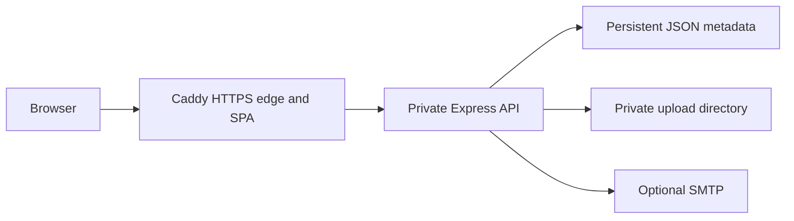

# My Drive v2 Threat Model

## Executive summary

My Drive v2 is a React and Express file-drive app with a single-host production Compose path. Caddy terminates HTTPS and keeps Express private, but the site is internet-reachable when its domain and ports are configured. Production registration uses a separate random invitation code for each allowlisted email; the main remaining risks are unthrottled login/upload traffic, a leaked per-email code, long-lived bearer share links, and browser-localStorage JWT exposure after XSS. JSON metadata and uploads remain on one host, so this is a controlled-beta setup rather than a horizontally scalable public service.

## Scope and assumptions

- In scope: React UI, Express API, authentication, file/folder/note handling, JSON persistence, local uploads, optional reminder email, Docker development configuration, and production Caddy/Compose configuration.
- Out of scope: the hosting provider, machine/OS hardening, browser internals, DNS/firewall state, and the SMTP provider itself. No systems outside this repository were tested.
- Confirmed context: the project is moving from a personal-machine demo toward web deployment; metadata must survive backend restarts. The provider and whether the beta is private or open to the public are not selected.
- Deployment assumption: one Linux host, one backend writer, and a domain reachable on ports 80/443. The production invite map is empty by default, which disables signup; approved users need the code mapped to their exact email. Login remains reachable to internet clients. Public multi-user exposure changes likelihoods as noted below.
- Assumed data sensitivity: ordinary personal files, account emails, notes, schedules, and share links; regulated or highly sensitive data is not assumed.
- Assumed runtime: the production Compose stack runs one backend process behind Caddy; internet clients can reach HTTPS endpoints, but only configured email addresses can register. Whether share links will be sent beyond the beta and whether stored files include regulated data remain unconfirmed.
- Open questions that would change risk: which users should be allowlisted, whether share links will be distributed outside the beta, and whether stored files include regulated data.

## System model

### Primary components

- **React 18 client:** registration/login, file/folder UI, DOCX extraction, and notes/realtime UI. JWTs are stored in browser `localStorage`; production shows an invitation-code field but receives no server secret in its build (`frontend/src/contexts/AuthContext.js`, `frontend/src/services/api.js`, `frontend/src/components/Register.js`, `frontend/Dockerfile`).
- **Express API:** authentication, file/folder CRUD, notes, upload/download, SSE, and optional reminder emails. Persisted reminders and interrupted permanent-delete staging are reconciled at startup (`backend/server.js`, `backend/app.js`, `backend/routes/`).
- **Metadata store:** versioned JSON at `backend/data/drive-store.json` by default, written through a temporary file and rename (`backend/storage/persistence.js`).
- **File store:** uploaded bytes in `backend/uploads/` by default; files are not mounted as a public static route (`backend/routes/files.js`).
- **Optional SMTP:** reminder email uses environment-provided credentials and includes schedule title/content (`backend/services/mailer.js`).
- **Development containers:** Compose mounts source, metadata, and uploads; publishes ports only on loopback and requires a configured JWT secret (`docker-compose.yml`).
- **Production edge:** Caddy serves the static React build, terminates HTTPS, and reverse-proxies `/api` to Express on the private Compose network (`frontend/Caddyfile`, `docker-compose.production.yml`).
- **Production containers:** only Caddy is published on ports 80/443. JSON metadata and uploaded bytes use persistent host bind mounts; Caddy stores its certificate/config state in named volumes (`docker-compose.production.yml`).

### Data flows and trust boundaries

- **Browser → Caddy → API:** credentials, invitation code, bearer JWT, file metadata, notes, and multipart files cross HTTPS to Caddy, then HTTP over the private Compose network to Express. Caddy handles TLS and serves the SPA with CSP; API CORS and the public API URL are restricted to the configured HTTPS domain. JSON/form bodies are size-limited and auth endpoints validate email/password/name. The invite secret is compared by the backend and is not compiled into the client (`frontend/Caddyfile`, `docker-compose.production.yml`, `backend/app.js`, `backend/routes/auth.js`, `backend/utils/runtimeConfig.js`).
- **API → metadata/filesystem:** account hashes, file/folder metadata, notes, and share tokens are persisted to local JSON; bytes are written to the upload directory. Atomic rename reduces partial JSON writes, but there is no encryption, database transaction, or multi-writer coordination (`backend/storage/persistence.js`, `backend/models/`).
- **Browser → DOCX parser:** an authenticated download is parsed by Mammoth as raw text and rendered as React text, avoiding an HTML injection sink (`frontend/src/services/docxPreview.js`, `frontend/src/components/Dashboard.js`).
- **Browser → SSE endpoint:** the authenticated API issues a short-lived, one-use ticket; the browser places that ticket in the EventSource URL. The JWT itself is not sent in the URL (`backend/routes/notes.js`, `backend/services/streamTickets.js`).
- **Share URL → API:** possession of a random share token permits downloading that file without a login. The file is returned as an attachment; the token has no expiry or owner-facing revocation path (`backend/routes/files.js`, `backend/models/File.js`).
- **API → SMTP (optional):** reminder title, body, dates, recipient email, and SMTP credentials cross the machine boundary. Title/body are escaped in generated HTML; SMTP is disabled unless credentials are configured (`backend/services/mailer.js`).
- **Developer → Docker:** development Compose mounts source and local data; production Compose builds a static React/Caddy image and a non-root Express image. Production bind mounts persist metadata and uploads; the runtime remains one host and one backend writer (`backend/Dockerfile`, `frontend/Dockerfile`, `docker-compose.yml`, `docker-compose.production.yml`).

#### Diagram

## Assets and security objectives

| Asset | Why it matters | Security objective (C/I/A) |
|---|---|---|
| Password hashes and JWT signing secret | Account takeover enables access to files, notes, and sharing controls. | C/I |
| Bearer JWT in browser storage | A stolen token can impersonate its owner until expiry. | C/I |
| Per-email registration codes | A leaked code can be used to claim the email address assigned to it. | C/I |
| File bytes and names | May contain personal documents; unauthorized downloads are the primary privacy harm. | C/I/A |
| JSON metadata | Connects users to files, ACLs, notes, schedules, and share tokens; corruption can break the whole demo. | C/I/A |
| Share-link token | It is a password-like capability to download one file. | C |
| Notes, schedules, reminder email | May expose personal plans and free-form content. | C/I |
| Local disk and API availability | Uploads, parser work, or malformed state can fill disk or prevent startup. | A |
| SMTP credentials (when configured) | Compromise can expose mailbox access or enable abuse of the configured account. | C/I |

## Attacker model

### Capabilities

- A remote user can reach the production web ports, attempt login, and submit unauthenticated share-link requests. Registration requires an exact email/code pair in `REGISTRATION_INVITES`; authenticated users can upload files up to the configured per-file limit. Auth/upload routes have no rate limiting.
- A malicious website can attempt cross-origin requests, but it cannot read the browser token through the same-origin policy; production serves a CSP and API CORS is allow-listed. Authentication uses an explicit bearer header.
- Anyone who obtains a share URL can use it as a bearer capability to download that file.
- A local process or person with access to the account can read or modify the local JSON and upload directories.
- Production Compose exposes Caddy publicly on ports 80/443. The API has no host port, but proxied API endpoints remain reachable through Caddy.

### Non-capabilities

- Public internet scanning or probing is not part of this review and was not performed.
- No attacker is assumed to have host, Docker daemon, or filesystem access before exploiting the application.
- There is no SQL database or SQL query surface in the current backend; SQL injection is not applicable to the JSON store.
- The API does not use cookie authentication, so classic ambient-cookie CSRF is not the primary request path. A successful XSS or stolen bearer token remains relevant.

## Entry points and attack surfaces

| Surface | How reached | Trust boundary | Notes | Evidence (repo path / symbol) |
|---|---|---|---|---|
| Register/login | Browser POST over public HTTPS | Browser → Caddy → API | Password hashed with bcrypt; 12-character minimum and 72-byte maximum. Production registration requires an exact email-specific invite code; login has no rate limit. | `backend/routes/auth.js` `/register`, `/login`; `backend/utils/runtimeConfig.js`; `docker-compose.production.yml` |
| File upload | Authenticated multipart POST | Browser → API → disk | 100 MiB per file, user quota check, folder ownership check, generated storage name. No malware scan or global disk quota. | `backend/routes/files.js` `/upload` |
| File download/preview | Authenticated GET | Browser → API → disk | Ownership/share access is checked; responses are attachments and upload paths are constrained. | `backend/routes/files.js` `/download/:id`, `/:id/preview`; `backend/models/File.js` `getFileByIdForUser` |
| Share-link download | Unauthenticated GET with token | Link holder → API → disk | Random bearer token; no expiry/revocation. | `backend/routes/files.js` `/link/:token/download`; `backend/models/File.js` `createShareLink` |
| Folder and file mutation | Authenticated JSON routes | Browser → API → JSON store | Folder parent ownership and file owner/editor checks exist. | `backend/routes/folders.js`; `backend/models/File.js` |
| Notes and SSE | Authenticated JSON plus EventSource | Browser → API | Notes have input/date validation; SSE tickets are short-lived and one-use. | `backend/routes/notes.js`; `backend/services/streamTickets.js` |
| DOCX preview | Open uploaded DOCX in UI | File parser in browser | Mammoth extracts raw text; React escapes displayed text. | `frontend/src/services/docxPreview.js`; `frontend/src/components/Dashboard.js` |
| Reminder email | Schedule/reminder trigger | API → SMTP provider | Optional credentials from environment; free-form title/content included in reminder. | `backend/services/mailer.js`; `backend/routes/notes.js` `scheduleReminder` |
| Startup/configuration | Process environment and JSON file | Operator → API | Production requires a configured 32-byte JWT secret; malformed JSON stops startup. | `backend/server.js`; `backend/storage/persistence.js` |

## Top abuse paths

1. **Steal an account token:** introduce an XSS in a future UI change → attacker JavaScript reads `localStorage` → attacker calls file APIs as the user → private files and notes are exposed despite TLS and CSP defense-in-depth.
2. **Abuse a leaked share URL:** obtain a copied/logged share URL → call its download route without login → download the associated file until the link is otherwise invalidated.
3. **Exhaust host storage:** compromise approved accounts or obtain multiple per-email codes → upload within per-user quotas → consume shared disk space and make uploads or the host fail.
4. **Exhaust browser resources:** upload a crafted, very large/compressed DOCX → have a user open its preview → client-side parsing consumes substantial memory/CPU or exploits a parser defect.
5. **Brute-force public auth:** reach the login endpoint → send repeated guesses against allowlisted accounts → take over an account if the password is reused or weak.
6. **Abuse an invitation leak:** obtain a tester's email-specific code → register first using that email → create an account under that address because mailbox ownership is not verified.
7. **Read local data after machine compromise:** gain access to the user account or a local process → read JSON metadata and uploaded bytes → recover files and share capabilities.
8. **Corrupt or race the JSON store:** run multiple backend processes against one `DATA_FILE`, or interrupt writes/storage → metadata updates can race or startup can stop on malformed JSON → the demo becomes unavailable or inconsistent.
9. **Leak schedule details through email:** configure SMTP and provide untrusted schedule text → email is sent to the configured account → content is exposed outside the local machine. HTML escaping prevents markup injection but does not make email private.

## Threat model table

| Threat ID | Threat source | Prerequisites | Threat action | Impact | Impacted assets | Existing controls (evidence) | Gaps | Recommended mitigations | Detection ideas | Likelihood | Impact severity | Priority |
|---|---|---|---|---|---|---|---|---|---|---|---|---|
| TM-001 | Malicious content or future frontend regression | Attacker can cause a UI XSS, for example through a future preview/rendering sink. | Read the JWT from `localStorage` and call authenticated file/note APIs. | Account impersonation and data theft. | JWT, files, metadata, notes | DOCX uses raw-text extraction and React rendering; API requires bearer auth; production Caddy serves a restrictive CSP (`docxPreview.js`, `middleware/auth.js`, `frontend/Caddyfile`). | Browser storage remains readable to any successful same-origin script; CSP is defense-in-depth and allows inline styles for the current app. | Prefer HttpOnly/Secure/SameSite cookies with CSRF protections if deployment expands; keep untrusted HTML out of DOM; add frontend XSS regression tests. | Review dependency/UI changes for unsafe sinks and add CSP violation reporting if needed. | Low for the current UI; medium if future code adds unsafe HTML or third-party scripts. | High | medium |
| TM-002 | Share-link recipient or anyone who obtains the URL | A user creates a share URL and it is copied, logged, or forwarded. | Use the token-only download endpoint without an account. | File disclosure until the capability stops working. | File bytes, share token | Random UUID token, attachment response, `no-store`, no-referrer (`models/File.js`, `routes/files.js`, `app.js`). | Link does not expire; no route rotates/revokes a link; URL can appear in browser/history or upstream logs. | Add owner-controlled revoke/rotate, optional expiry, and link download audit; avoid logging token paths. | Record share-link creation/revocation and download events without logging raw tokens. | Medium if links are shared; lower for a single-user local demo. | High | medium |
| TM-003 | Approved beta user or compromised invitee | A user has an account or possesses a valid email-specific registration invitation. | Upload enough files to exhaust shared disk within that account's quota. | Uploads fail; host or JSON persistence can become unavailable. | Disk, uploads, metadata, API availability | Production signup requires an exact email/code pair; uploads have a 100 MiB per-file cap and 15 GiB default per-user quota; API port is private (`routes/auth.js`, `routes/files.js`, `models/File.js`, `docker-compose.production.yml`). | No global quota, upload rate limit, or disk-space guard; an approved user can fill the host disk and trash still occupies bytes. | Keep the invite list small; add a global disk budget and low-disk rejection before broader use. | Monitor free disk, upload bytes, and rejected quota requests. | Low for a small beta; medium if opened to broader users. | High | medium |
| TM-004 | Malicious file uploader | Attacker can upload a crafted DOCX and persuade a user to preview it. | Trigger excessive decompression/parsing work or exploit a future parser flaw in Mammoth. | Browser tab instability or code execution in the browser context if a parser vulnerability exists. | Browser session, JWT, client availability | 100 MiB limit; DOCX renders extracted text rather than converted HTML (`routes/files.js`, `services/docxPreview.js`). | No compressed/unpacked size budget, parser worker isolation, or malware scanning. | Add preview size limits and parse in a worker with timeout; skip preview for large files; keep Mammoth updated. | Track preview errors and duration; test malformed and highly compressed DOCX fixtures. | Low in local use; medium with untrusted shared uploads. | Medium | low |
| TM-005 | Internet attacker | Public deployment is live and the operator chooses a predictable signing secret or leaks it. | Forge a bearer JWT and impersonate any account. | Full account-level access to files, notes, and metadata. | JWT, files, notes, metadata | Production rejects missing, placeholder, or shorter-than-32-byte secrets; backend port is private; frontend/API use one HTTPS domain (`server.js`, `docker-compose.production.yml`). | Length is not entropy; `.env` and host permissions are operator-managed; there is no automated rotation process. | Generate a cryptographically random secret, restrict `.env` permissions, never commit it, and rotate after exposure. | Log invalid configuration without printing the value; review host access to `.env`. | Low if random-secret instructions are followed; medium otherwise. | High | medium |
| TM-006 | Local user/process or stolen device | Attacker gains local account or filesystem access. | Read or modify metadata and uploaded file directories. | Private files, account emails, notes, and share tokens are disclosed or corrupted. | JSON store, files, credentials | JSON file mode requests owner-only permissions and Git ignores runtime data (`storage/persistence.js`, `.gitignore`). | Files are not encrypted at rest; Windows ACL behavior is not enforced by the POSIX mode bit; backups are not configured. | Use OS disk encryption and restrictive directory ACLs; back up metadata and uploads together; keep backups private. | Monitor unexpected file changes and maintain tested backups. | Low absent a local compromise. | High | medium |
| TM-007 | Operator error or concurrent backend process | More than one backend process writes the same `DATA_FILE`, or disk/write fails. | Race snapshots or interrupt state updates. | Missing/inconsistent metadata or startup failure; an interrupted upload can leave orphaned bytes. | Metadata integrity and availability | Production Compose starts one backend and mounts both persistent paths; writes serialize within one process and use temporary-file rename; staged folder deletion is reconciled at startup (`docker-compose.production.yml`, `storage/persistence.js`, `services/pendingFileDeletes.js`). | No cross-process lock, transaction log, schema migration tooling, or automatic backup. Manual scaling or host disk failure can lose or corrupt state. | Keep one backend writer; back up metadata and uploads together; migrate to a transactional database before multi-instance use. | Log persistence errors and periodically verify backup restoration. | Low if operated as documented; medium if scaled or disk failures occur. | High | medium |
| TM-008 | External email recipient/provider | SMTP credentials are configured and reminders are enabled. | Read schedule details delivered by the mail provider or mailbox. | Personal notes/schedule content leaves the local trust boundary. | SMTP secret, schedule data | SMTP is disabled without credentials; HTML content is escaped; pending reminders are rescheduled from persisted notes after restart, with long delays chunked safely (`services/mailer.js`, `routes/notes.js`, `services/scheduleTimeout.js`). | Email text includes full schedule details and delivery is external to the machine. | Make reminder content minimal/configurable; use a dedicated app password and provider TLS; document the data sent. | Keep SMTP delivery logs metadata-only and monitor failed/unknown recipients. | Low unless SMTP is configured. | Medium | low |
| TM-009 | Collaborator with access to a shared file | Owner and collaborator both view or favorite the same file. | Inspect API file activity fields to infer another user's access pattern. | Privacy loss about file access and preferences. | Per-user recent/favorite metadata | Recent timestamps and favorites are stored per user and serializers return only the requester's values; shared-file activity has a regression test (`models/File.js`, `routes/files.js`, `test/trash-api.test.js`). | Future routes that serialize raw model objects could reintroduce cross-user metadata disclosure. | Reuse the user-scoped serializer for every authenticated file response; keep regression tests on shared-file routes. | Review API response shapes when adding file endpoints. | Low after the fix; medium if a raw serializer is reused. | Low | low |
| TM-010 | Credential-stuffing attacker | Public deployment is reachable and a target has an account. | Repeatedly guess credentials through `/login` against a registered account. | Account takeover if the password is reused or guessed. | Accounts, JWTs, files, notes | Passwords use bcrypt; registration requires a per-email code; HTTPS is enabled (`models/User.js`, `routes/auth.js`, `docker-compose.production.yml`). | No login throttling, MFA, or breached-password screening; the registration gate does not limit login attempts. | Add vetted login rate limiting and account recovery safeguards before broad public use; retain generic login errors. | Track auth failures without logging credentials and alert on repeated attempts. | Medium for an internet-reachable site. | High | high |
| TM-011 | Attacker who obtains a tester's invitation code | A tester's per-email code leaks. | Register first using the email assigned to that code; mailbox ownership is not verified. | Account squatting and possible denial of account access for the intended user. | Account identity, files, JWTs | Production maps each code to one normalized email, compares it in the backend, uses HTTPS, and disables registration when the map is empty (`routes/auth.js`, `runtimeConfig.js`, `docker-compose.production.yml`). | Codes are reusable and email ownership is not verified; a leaked code can still claim its assigned address. | Share codes privately with the matching tester, rotate a leaked code, and add email verification or one-time invitations before broad public use. | Log registration denials without recording submitted codes; audit invite-map and account-creation changes. | Low for a private beta if codes are handled carefully; medium if shared broadly. | High | medium |

## Criticality calibration

- **Critical:** unauthenticated host compromise or cross-account access at scale. Examples: API code execution, authorization bypass exposing all users' files, or JWT forgery after signing-secret compromise.
- **High:** account compromise or service outage with meaningful user impact. Examples: XSS token theft, a leaked share URL, or an approved user filling the host disk.
- **Medium:** bounded privacy loss or recoverable service degradation. Examples: one shared-file disclosure, a reminder email sent to an unintended recipient, or a crafted preview disrupting one browser.
- **Low:** limited, recoverable impact. Examples: one user's quota rejection, duplicate recent-file state, or a health check failure before the service is used.

## Focus paths for security review

| Path | Why it matters | Related Threat IDs |
|---|---|---|
| `backend/server.js` | Bind address, secret checks, startup ordering, and persistent paths define runtime exposure. | TM-005, TM-007 |
| `backend/app.js` | CORS, request limits, security headers, and error responses protect the API boundary. | TM-001, TM-003 |
| `backend/middleware/auth.js` | JWT verification gates authenticated operations. | TM-001, TM-005 |
| `backend/utils/runtimeConfig.js` | Production URL validation, email-to-code map validation, and constant-time per-email comparisons live here. | TM-003, TM-010, TM-011 |
| `frontend/src/components/Register.js` | Collects the production invitation code without embedding the backend secret in the browser bundle. | TM-011 |
| `backend/routes/files.js` | Upload, private download, share links, and deletion are the main data surfaces. | TM-002, TM-003, TM-004 |
| `backend/models/File.js` | Ownership, sharing, trash, path containment, and metadata mutations live here. | TM-002, TM-003, TM-007 |
| `backend/storage/persistence.js` | Local metadata integrity and atomic writes are implemented here. | TM-006, TM-007 |
| `backend/services/pendingFileDeletes.js` | Recoverable staging protects folder contents during permanent deletion and startup recovery. | TM-007 |
| `backend/routes/notes.js` | Note validation, SSE ticketing, and reminder scheduling are handled here. | TM-001, TM-008 |
| `backend/services/mailer.js` | SMTP secret use and untrusted schedule text enter HTML email here. | TM-008 |
| `frontend/src/contexts/AuthContext.js` | Browser token storage and session handling are defined here. | TM-001 |
| `frontend/src/services/docxPreview.js` | Uploaded DOCX content is parsed at this boundary. | TM-004 |
| `docker-compose.yml` | Development host bindings and persistent bind mounts affect local exposure and data durability. | TM-005, TM-006, TM-007 |
| `docker-compose.production.yml` | Public ports, private backend networking, persistent mounts, container permissions, and health checks define the deployment boundary. | TM-003, TM-005, TM-007, TM-010 |
| `frontend/Caddyfile` | TLS edge routes API traffic and serves the static app with security headers and CSP. | TM-001, TM-003, TM-010 |

## Notes on use

- The user wants web deployment but has not chosen a provider or confirmed whether the beta is private or public. Ratings assume a single-host controlled beta reachable through a public domain with operator-managed per-email codes; broadening access raises TM-003, TM-010, and TM-011.
- `npm audit --offline` reported zero advisories using the local cache; this is not a fresh online registry audit.
- Docker and Node were unavailable in the current shell, so the production image build, Compose interpolation, and Caddy runtime remain unverified here.
- No production deployment or external target testing was performed.
