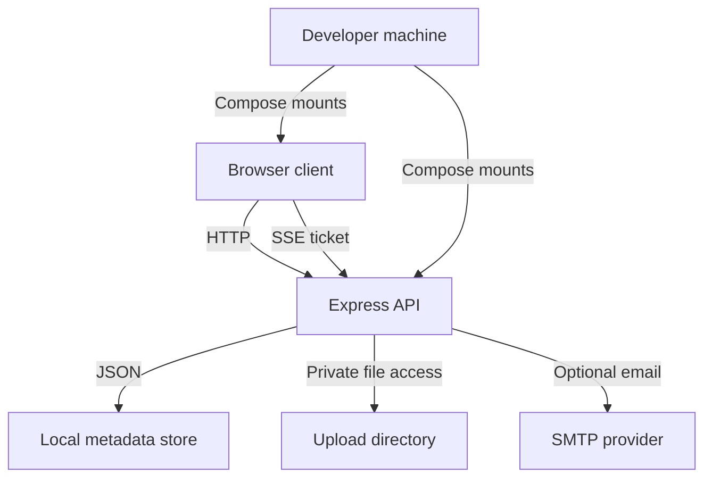

# My Drive v2 Threat Model

## Executive summary

My Drive v2 is a local React and Express file-drive demo. The main risks are theft of the bearer token from browser storage if an XSS is introduced, exposure of a share URL because it is a long-lived bearer capability, and disk exhaustion from uploads or document parsing. The default backend and Docker Compose ports are loopback-bound, which materially lowers remote exposure for the confirmed personal-machine use. JSON metadata and uploaded files are stored locally without encryption or a multi-instance database.

## Scope and assumptions

- In scope: React UI, Express API, authentication, file/folder/note handling, JSON persistence, local uploads, optional reminder email, and Docker development configuration.
- Out of scope: the machine/OS, browser internals, GitHub hosting, public deployment, and the SMTP provider itself. No systems outside this repository were tested.
- Confirmed context: local/demo use on a personal machine; metadata must survive backend restarts.
- Assumed data sensitivity: ordinary personal files, account emails, notes, schedules, and share links; regulated or highly sensitive data is not assumed.
- Assumed runtime: one local backend process, with no untrusted LAN or internet clients. The app supports multiple accounts and sharing, but whether links will be sent to people outside the machine is unconfirmed.
- Open questions that would change risk: whether other people can reach the backend, whether share links leave the machine, and whether the stored files include regulated data.

## System model

### Primary components

- **React 18 client:** registration/login, file/folder UI, DOCX extraction, and notes/realtime UI. JWTs are stored in browser `localStorage` (`frontend/src/contexts/AuthContext.js`, `frontend/src/services/api.js`).
- **Express API:** authentication, file/folder CRUD, notes, upload/download, SSE, and optional reminder emails. Persisted reminders and interrupted permanent-delete staging are reconciled at startup (`backend/server.js`, `backend/app.js`, `backend/routes/`).
- **Metadata store:** versioned JSON at `backend/data/drive-store.json` by default, written through a temporary file and rename (`backend/storage/persistence.js`).
- **File store:** uploaded bytes in `backend/uploads/` by default; files are not mounted as a public static route (`backend/routes/files.js`).
- **Optional SMTP:** reminder email uses environment-provided credentials and includes schedule title/content (`backend/services/mailer.js`).
- **Development containers:** Compose mounts source, metadata, and uploads; publishes ports only on loopback and requires a configured JWT secret (`docker-compose.yml`).

### Data flows and trust boundaries

- **Browser → API:** credentials, bearer JWT, file metadata, notes, and multipart files cross HTTP. CORS is allow-listed; JSON/form bodies are size-limited; auth endpoints validate email/password/name. Loopback HTTP has no transport encryption (`backend/app.js`, `backend/routes/auth.js`).
- **API → metadata/filesystem:** account hashes, file/folder metadata, notes, and share tokens are persisted to local JSON; bytes are written to the upload directory. Atomic rename reduces partial JSON writes, but there is no encryption, database transaction, or multi-writer coordination (`backend/storage/persistence.js`, `backend/models/`).
- **Browser → DOCX parser:** an authenticated download is parsed by Mammoth as raw text and rendered as React text, avoiding an HTML injection sink (`frontend/src/services/docxPreview.js`, `frontend/src/components/Dashboard.js`).
- **Browser → SSE endpoint:** the authenticated API issues a short-lived, one-use ticket; the browser places that ticket in the EventSource URL. The JWT itself is not sent in the URL (`backend/routes/notes.js`, `backend/services/streamTickets.js`).
- **Share URL → API:** possession of a random share token permits downloading that file without a login. The file is returned as an attachment; the token has no expiry or owner-facing revocation path (`backend/routes/files.js`, `backend/models/File.js`).
- **API → SMTP (optional):** reminder title, body, dates, recipient email, and SMTP credentials cross the machine boundary. Title/body are escaped in generated HTML; SMTP is disabled unless credentials are configured (`backend/services/mailer.js`).
- **Developer → Docker:** image builds consume package manifests and source; Compose bind-mounts persistent local data. This is development tooling, not a production deployment (`backend/Dockerfile`, `frontend/Dockerfile`, `docker-compose.yml`).

#### Diagram

## Assets and security objectives

| Asset | Why it matters | Security objective (C/I/A) |
|---|---|---|
| Password hashes and JWT signing secret | Account takeover enables access to files, notes, and sharing controls. | C/I |
| Bearer JWT in browser storage | A stolen token can impersonate its owner until expiry. | C/I |
| File bytes and names | May contain personal documents; unauthorized downloads are the primary privacy harm. | C/I/A |
| JSON metadata | Connects users to files, ACLs, notes, schedules, and share tokens; corruption can break the whole demo. | C/I/A |
| Share-link token | It is a password-like capability to download one file. | C |
| Notes, schedules, reminder email | May expose personal plans and free-form content. | C/I |
| Local disk and API availability | Uploads, parser work, or malformed state can fill disk or prevent startup. | A |
| SMTP credentials (when configured) | Compromise can expose mailbox access or enable abuse of the configured account. | C/I |

## Attacker model

### Capabilities

- A local user can operate the browser, register an account, upload arbitrary files up to the configured per-file limit, and provide note/share input.
- A malicious website can attempt cross-origin requests, but it cannot read the browser token through the same-origin policy; API CORS is allow-listed and authentication uses an explicit bearer header.
- Anyone who obtains a share URL can use it as a bearer capability to download that file.
- A local process or person with access to the account can read or modify the local JSON and upload directories.
- If the operator changes `HOST` or port publishing to expose the service, network attackers gain the API entry points described below.

### Non-capabilities

- Public internet scanning or probing is not part of this review and was not performed.
- Under the confirmed default setup, a remote internet user cannot connect to the backend bound to `127.0.0.1`; this assumption no longer holds if the host binding or Compose port mapping changes.
- There is no SQL database or SQL query surface in the current backend; SQL injection is not applicable to the JSON store.
- The API does not use cookie authentication, so classic ambient-cookie CSRF is not the primary request path. A successful XSS or stolen bearer token remains relevant.

## Entry points and attack surfaces

| Surface | How reached | Trust boundary | Notes | Evidence (repo path / symbol) |
|---|---|---|---|---|
| Register/login | Browser POST over HTTP | Browser → API | Password hashed with bcrypt; 12-character minimum and 72-byte maximum. No rate limit. | `backend/routes/auth.js` `/register`, `/login`; `backend/models/User.js` |
| File upload | Authenticated multipart POST | Browser → API → disk | 100 MiB per file, user quota check, folder ownership check, generated storage name. No malware scan or global disk quota. | `backend/routes/files.js` `/upload` |
| File download/preview | Authenticated GET | Browser → API → disk | Ownership/share access is checked; responses are attachments and upload paths are constrained. | `backend/routes/files.js` `/download/:id`, `/:id/preview`; `backend/models/File.js` `getFileByIdForUser` |
| Share-link download | Unauthenticated GET with token | Link holder → API → disk | Random bearer token; no expiry/revocation. | `backend/routes/files.js` `/link/:token/download`; `backend/models/File.js` `createShareLink` |
| Folder and file mutation | Authenticated JSON routes | Browser → API → JSON store | Folder parent ownership and file owner/editor checks exist. | `backend/routes/folders.js`; `backend/models/File.js` |
| Notes and SSE | Authenticated JSON plus EventSource | Browser → API | Notes have input/date validation; SSE tickets are short-lived and one-use. | `backend/routes/notes.js`; `backend/services/streamTickets.js` |
| DOCX preview | Open uploaded DOCX in UI | File parser in browser | Mammoth extracts raw text; React escapes displayed text. | `frontend/src/services/docxPreview.js`; `frontend/src/components/Dashboard.js` |
| Reminder email | Schedule/reminder trigger | API → SMTP provider | Optional credentials from environment; free-form title/content included in reminder. | `backend/services/mailer.js`; `backend/routes/notes.js` `scheduleReminder` |
| Startup/configuration | Process environment and JSON file | Operator → API | Production requires a configured 32-byte JWT secret; malformed JSON stops startup. | `backend/server.js`; `backend/storage/persistence.js` |

## Top abuse paths

1. **Steal an account token:** introduce an XSS in a future UI change → attacker JavaScript reads `localStorage` → attacker calls file APIs as the user → private files and notes are exposed.
2. **Abuse a leaked share URL:** obtain a copied/logged share URL → call its download route without login → download the associated file until the link is otherwise invalidated.
3. **Exhaust local storage:** register or access multiple accounts → upload many files within each per-user quota → consume shared disk space and make uploads or the host fail.
4. **Exhaust browser resources:** upload a crafted, very large/compressed DOCX → have a user open its preview → client-side parsing consumes substantial memory/CPU or exploits a parser defect.
5. **Expose the development secret:** run with the known development fallback while binding to a non-loopback interface → attacker signs a JWT → attacker impersonates an account.
6. **Read local data after machine compromise:** gain access to the user account or a local process → read JSON metadata and uploaded bytes → recover files and share capabilities.
7. **Corrupt or race the JSON store:** run multiple backend processes against one `DATA_FILE`, or interrupt writes/storage → metadata updates can race or startup can stop on malformed JSON → the demo becomes unavailable or inconsistent.
8. **Leak schedule details through email:** configure SMTP and provide untrusted schedule text → email is sent to the configured account → content is exposed outside the local machine. HTML escaping prevents markup injection but does not make email private.

## Threat model table

| Threat ID | Threat source | Prerequisites | Threat action | Impact | Impacted assets | Existing controls (evidence) | Gaps | Recommended mitigations | Detection ideas | Likelihood | Impact severity | Priority |
|---|---|---|---|---|---|---|---|---|---|---|---|---|
| TM-001 | Malicious content or future frontend regression | Attacker can cause a UI XSS, for example through a future preview/rendering sink. | Read the JWT from `localStorage` and call authenticated file/note APIs. | Account impersonation and data theft. | JWT, files, metadata, notes | DOCX uses raw-text extraction and React rendering; API requires bearer auth (`docxPreview.js`, `middleware/auth.js`). | Browser storage remains readable to any successful same-origin script; no CSP is served by the frontend host. | Prefer HttpOnly/Secure/SameSite cookies with CSRF protections if deployment expands; keep untrusted HTML out of DOM; add frontend CSP and XSS tests. | Add CSP violation reporting and review dependency/UI changes for unsafe sinks. | Low in current local use; higher if the UI gains third-party scripts or HTML sinks. | High | medium |
| TM-002 | Share-link recipient or anyone who obtains the URL | A user creates a share URL and it is copied, logged, or forwarded. | Use the token-only download endpoint without an account. | File disclosure until the capability stops working. | File bytes, share token | Random UUID token, attachment response, `no-store`, no-referrer (`models/File.js`, `routes/files.js`, `app.js`). | Link does not expire; no route rotates/revokes a link; URL can appear in browser/history or upstream logs. | Add owner-controlled revoke/rotate, optional expiry, and link download audit; avoid logging token paths. | Record share-link creation/revocation and download events without logging raw tokens. | Medium if links are shared; lower for a single-user local demo. | High | medium |
| TM-003 | Authenticated user or local account registrant | Attacker can create accounts and upload repeatedly; registration has no rate limit. | Fill local disk using per-file uploads and each account's per-user quota. | Uploads fail; host or JSON persistence can become unavailable. | Disk, uploads, metadata, API availability | 100 MiB per-file cap and 15 GiB default per-user quota (`routes/files.js`, `models/File.js`). | No global quota, account cap, upload rate limit, or disk-space guard; trash still occupies bytes. | Add a global disk budget and registration/upload throttles; reject before disk exhaustion; document trash accounting. | Monitor free disk, upload bytes, rejected quota requests, and registration spikes. | Low for personal local use; medium if exposed to other users. | High | medium |
| TM-004 | Malicious file uploader | Attacker can upload a crafted DOCX and persuade a user to preview it. | Trigger excessive decompression/parsing work or exploit a future parser flaw in Mammoth. | Browser tab instability or code execution in the browser context if a parser vulnerability exists. | Browser session, JWT, client availability | 100 MiB limit; DOCX renders extracted text rather than converted HTML (`routes/files.js`, `services/docxPreview.js`). | No compressed/unpacked size budget, parser worker isolation, or malware scanning. | Add preview size limits and parse in a worker with timeout; skip preview for large files; keep Mammoth updated. | Track preview errors and duration; test malformed and highly compressed DOCX fixtures. | Low in local use; medium with untrusted shared uploads. | Medium | low |
| TM-005 | Network attacker after operator changes exposure | Backend is bound to a non-loopback interface and a weak or compromised explicit secret is configured. | Sign a valid JWT and impersonate users. | Full account-level access to data reachable by that token. | JWT, files, notes, metadata | Default host is loopback; the deterministic fallback is rejected on non-loopback hosts; production rejects missing/placeholder/short secrets; Compose requires a root secret (`server.js`, `docker-compose.yml`). | The app enforces minimum secret length, not entropy; an operator can still choose a predictable 32-byte string. | Generate a random secret for any shared network run; keep it out of source control and rotate it if exposed. | Log only whether a secret is configured and the bind address; alert on non-loopback dev binds. | Low under confirmed deployment; medium if exposed with an explicit weak secret. | High | medium |
| TM-006 | Local user/process or stolen device | Attacker gains local account or filesystem access. | Read or modify metadata and uploaded file directories. | Private files, account emails, notes, and share tokens are disclosed or corrupted. | JSON store, files, credentials | JSON file mode requests owner-only permissions and Git ignores runtime data (`storage/persistence.js`, `.gitignore`). | Files are not encrypted at rest; Windows ACL behavior is not enforced by the POSIX mode bit; backups are not configured. | Use OS disk encryption and restrictive directory ACLs; back up metadata and uploads together; keep backups private. | Monitor unexpected file changes and maintain tested backups. | Low absent a local compromise. | High | medium |
| TM-007 | Operator error or concurrent local process | More than one backend process writes the same JSON path, or disk/write fails. | Race snapshots or interrupt state updates. | Missing/inconsistent metadata or startup failure; an interrupted upload can leave orphaned bytes. | Metadata integrity and availability | Writes serialize within one process and use temporary-file rename; a failed latest write restores in-memory metadata to the last committed snapshot and blocks later writes until restart; interrupted permanent-folder deletion is staged and reconciled on startup; invalid JSON stops startup (`storage/persistence.js`, `services/pendingFileDeletes.js`). | No cross-process lock, transaction log, schema migration tooling, or automatic backup. A crash during upload can leave orphan bytes. | Enforce one writer; add backup/restore workflow and integrity checks; migrate to a transactional database before multi-instance use. | Log persistence errors and run periodic backup verification. | Low for one process; medium if Compose and a local server share the same path. | Medium | low |
| TM-008 | External email recipient/provider | SMTP credentials are configured and reminders are enabled. | Read schedule details delivered by the mail provider or mailbox. | Personal notes/schedule content leaves the local trust boundary. | SMTP secret, schedule data | SMTP is disabled without credentials; HTML content is escaped; pending reminders are rescheduled from persisted notes after restart, with long delays chunked safely (`services/mailer.js`, `routes/notes.js`, `services/scheduleTimeout.js`). | Email text includes full schedule details and delivery is external to the machine. | Make reminder content minimal/configurable; use a dedicated app password and provider TLS; document the data sent. | Keep SMTP delivery logs metadata-only and monitor failed/unknown recipients. | Low unless SMTP is configured. | Medium | low |
| TM-009 | Collaborator with access to a shared file | Owner and collaborator both view or favorite the same file. | Inspect API file activity fields to infer another user's access pattern. | Privacy loss about file access and preferences. | Per-user recent/favorite metadata | Recent timestamps and favorites are stored per user and serializers return only the requester's values; shared-file activity has a regression test (`models/File.js`, `routes/files.js`, `test/trash-api.test.js`). | Future routes that serialize raw model objects could reintroduce cross-user metadata disclosure. | Reuse the user-scoped serializer for every authenticated file response; keep regression tests on shared-file routes. | Review API response shapes when adding file endpoints. | Low after the fix; medium if a raw serializer is reused. | Low | low |

## Criticality calibration

- **Critical:** remote unauthenticated compromise of the host or mass cross-account file access. Example: remote code execution through an API parser; an authorization bypass exposing all local files; forged JWTs accepted on an internet-facing deployment.
- **High:** compromise of one account or disclosure of a private file. Example: XSS token theft; leaked share link; an exposed development secret used to impersonate a user.
- **Medium:** meaningful local outage or bounded privacy loss. Example: exhausting a personal disk; reminder content sent to an unintended mailbox; a crafted document makes a browser unusable.
- **Low:** limited or recoverable issue with little data exposure. Example: duplicate recent-file state; one user's quota rejection; a failed local Compose health check before use.

## Focus paths for security review

| Path | Why it matters | Related Threat IDs |
|---|---|---|
| `backend/server.js` | Bind address, secret checks, startup ordering, and persistent paths define runtime exposure. | TM-005, TM-007 |
| `backend/app.js` | CORS, request limits, security headers, and error responses protect the API boundary. | TM-001, TM-003 |
| `backend/middleware/auth.js` | JWT verification gates authenticated operations. | TM-001, TM-005 |
| `backend/routes/files.js` | Upload, private download, share links, and deletion are the main data surfaces. | TM-002, TM-003, TM-004 |
| `backend/models/File.js` | Ownership, sharing, trash, path containment, and metadata mutations live here. | TM-002, TM-003, TM-007 |
| `backend/storage/persistence.js` | Local metadata integrity and atomic writes are implemented here. | TM-006, TM-007 |
| `backend/services/pendingFileDeletes.js` | Recoverable staging protects folder contents during permanent deletion and startup recovery. | TM-007 |
| `backend/routes/notes.js` | Note validation, SSE ticketing, and reminder scheduling are handled here. | TM-001, TM-008 |
| `backend/services/mailer.js` | SMTP secret use and untrusted schedule text enter HTML email here. | TM-008 |
| `frontend/src/contexts/AuthContext.js` | Browser token storage and session handling are defined here. | TM-001 |
| `frontend/src/services/docxPreview.js` | Uploaded DOCX content is parsed at this boundary. | TM-004 |
| `docker-compose.yml` | Host port binding, secrets, and persistent bind mounts affect exposure and data durability. | TM-005, TM-006, TM-007 |

## Notes on use

- The threat ranking reflects the user's confirmed personal-machine, local/demo deployment. Reassess TM-002/TM-003/TM-005 if the service is exposed to a LAN or the internet.
- `npm audit --offline` reported zero advisories using the local cache; this is not a fresh online registry audit.
- Docker Compose YAML parsed locally, but Docker was unavailable, so image builds and container runtime behavior remain unverified.
- No production deployment or external target testing was performed.
